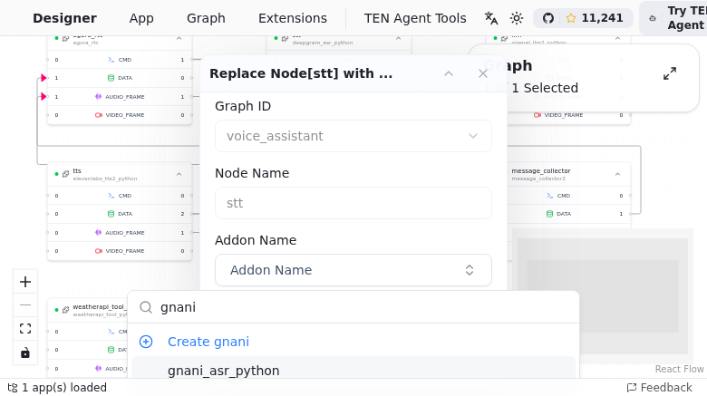

# Gnani AI Prisma STT

Streams 16 kHz mono signed 16-bit little-endian PCM to Gnani and emits TEN
`asr_result` messages for completed utterances. Set `GNANI_API_KEY` in the
agent environment before starting the graph.

Install the standard voice-assistant example. In local TMAN Designer open the
voice_assistant graph, right-click the stt node, select **Replace Node**, search
for **gnani** and select **gnani_asr_python**. Edit the node properties and save.
Reopen the graph to inspect the selected model.



```json
{"params":{"api_key":"${env:GNANI_API_KEY|}","model":"prisma-v3.0","language":"indic-auto","sample_rate":16000}}
```

The default is `prisma-v2.5` with `en-IN`. Both models accept one supported
Indian locale. Prisma v3.0 additionally accepts `indic-auto`. The extension
requests verbatim formatting and a 20-second speech segment limit for continuous audio. Language lists are unsupported in this adapter.
Segment times are estimates derived from the provider's speech-start offset
and duration. Reconnection can lose speech already transmitted to Gnani.

See the [streaming protocol](https://docs.gnani.ai/api/STT/stt-websocket).

The Hindi test fixture says “नमस्ते, मेरा नाम राहुल है।” and was generated
locally using eSpeak NG's Hindi voice at 145 words per minute. It includes
1.2 seconds of trailing silence for provider voice activity detection.

## Verification

From `ai_agents` inside the TEN development container:

```sh
task lint-extension EXTENSION=gnani_asr_python
task test-extension EXTENSION=agents/ten_packages/extension/gnani_asr_python
task asr-guarder-test EXTENSION=gnani_asr_python CONFIG_DIR=tests/configs/prisma_v25
```

The standalone suite runs the provider tests when `GNANI_API_KEY` is set.
Repeat Guarder with `tests/configs/prisma_v30` and
`tests/configs/prisma_v30_auto`. To test the STT node saved by Designer, set
`GNANI_DESIGNER_GRAPH` to the saved property.json path in the container and
run the standalone suite. The fixture source and transcript receiver require
only the Gnani credential.

## Turn completion and recovery

Gnani's commit control closes an open utterance. The service does not provide
a transcript-drain acknowledgement. The adapter listens for the full five seconds after commit, even when an earlier
segment has already completed. This gives delayed segments a chance to arrive
and bounds how long the next turn can wait. It reports an error for outstanding
speech at the deadline, logs the unconfirmed drain otherwise, and retires the
retiring socket before acknowledging finalize. The finalize-end metadata carries
`gnani_drain_confirmed: false` when the service cannot confirm the drain. Results delayed beyond this window can
be lost. An empty event queue cannot distinguish silence from unreported speech.
Temporary transport failures retry with exponential backoff capped at four
seconds. Authentication and invalid configuration errors stop retries.

On commit the adapter opens a new sending session while the retiring session
drains. Up to two Gnani sessions can overlap and count against the provider's
concurrency quota. TEN receives transcripts and finalize acknowledgements in
turn order. Each connection has its own timeline and segment identifiers.
The five-second input queue absorbs transient connection and pacing delays.
If the service stays unavailable or the queue fills, the adapter drops its
oldest queued frames and emits an ASR error.
